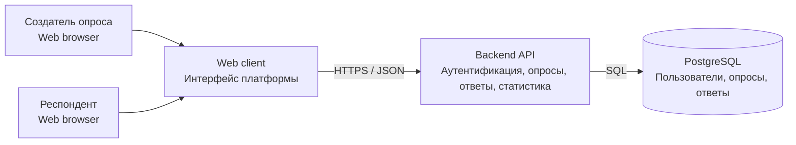
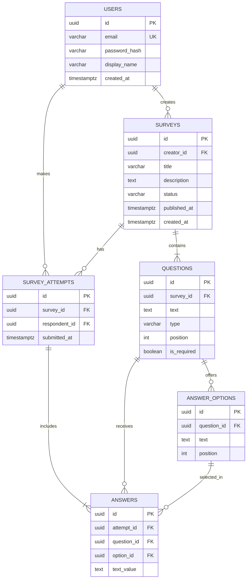

# Архитектура Survey Tool

## Краткая теория

Серверное приложение принимает запросы клиентов, выполняет бизнес-логику,
сохраняет данные и при необходимости взаимодействует с внешними системами.
До написания кода проектируют предметную область, архитектуру и базу данных:
это помогает заранее определить границы системы и избежать дублирования данных.

### Как работает серверное приложение

Клиентское приложение работает в браузере и отправляет серверу HTTP-запросы.
Сервер проверяет пользователя и входные данные, выполняет бизнес-правила,
обращается к базе данных и возвращает ответ, чаще всего в формате JSON.
Такой обмен можно представить цепочкой:

```text
Браузер -> HTTP-запрос -> Backend API -> PostgreSQL -> JSON-ответ -> Браузер
```

Например, при отправке ответов на опрос браузер передаёт идентификатор опроса
и выбранные варианты. Backend API проверяет, опубликован ли опрос и не проходил
ли пользователь его раньше. Затем он создаёт запись о прохождении и сохраняет
ответы. После этого клиент получает подтверждение.

### Архитектура и разделение ответственности

Архитектура определяет, из каких крупных частей состоит приложение и как они
взаимодействуют. В нашем случае выбрана клиент-серверная архитектура:

- Web client отображает страницы, формы и результаты опросов.
- Backend API хранит бизнес-логику, выполняет проверки прав и обрабатывает запросы.
- PostgreSQL надёжно хранит пользователей, опросы и ответы.

Внутри Backend API логика должна быть разделена на модули: аутентификация,
опросы, прохождения и статистика. Это модульный монолит: приложение
развёртывается как единый сервер, но код не смешивает несвязанные обязанности.
Такой подход проще для небольшой системы, чем микросервисы, и позволяет позднее
выделить отдельный модуль в сервис, если это действительно понадобится.

### Модель предметной области

Предметная область описывает сущности системы, их свойства и связи. Для
Survey Tool основными сущностями являются пользователь, опрос, вопрос,
вариант ответа, прохождение опроса и ответ. Такая модель отвечает на вопрос,
какие данные нужны системе и как они связаны между собой.

При моделировании полезно сначала сформулировать бизнес-правила, а затем
выделять сущности. Правило «один пользователь проходит опрос только один раз»
приводит к сущности `survey_attempts` и уникальному ограничению на пару
`survey_id` и `respondent_id`. Правило «вопросы бывают разных типов» приводит
к полю `type` у вопроса. Так требования превращаются в структуру данных,
которую можно проверить на уровне базы данных.

### C4 Model

C4 Model - подход к документированию архитектуры на нескольких уровнях.
Название C4 происходит от четырёх уровней детализации: System Context,
Container, Component и Code. Чем ниже уровень, тем больше технических деталей.

- **System Context (Level 1)** показывает Survey Tool как единый продукт,
  его пользователей и внешние системы. Здесь не рисуют таблицы и внутренние модули.
- **Container (Level 2)** показывает крупные технические части: Web client,
  Backend API, PostgreSQL, а при наличии - Redis или брокер сообщений.
- **Component (Level 3)** раскрывает внутреннюю структуру одного контейнера,
  например контроллеры, сервисы и репозитории Backend API.
- **Code (Level 4)** отражает классы или модули кода и обычно нужен только для
  сложных частей реализации.

В лабораторной требуется Level 2. Наша диаграмма показывает, что Web client
отправляет HTTP-запросы в Backend API, а API выполняет SQL-запросы к PostgreSQL.
Это позволяет объяснить путь данных от действия пользователя до их хранения.

### ERD и третья нормальная форма

ERD (Entity-Relationship Diagram) показывает таблицы базы данных, их поля и
связи через первичные и внешние ключи. Третья нормальная форма (3НФ) означает,
что данные об одной сущности хранятся в отдельной таблице, а неключевые поля
зависят только от её ключа. Благодаря этому данные не дублируются, их проще
изменять и поддерживать в согласованном состоянии.

Первичный ключ (Primary Key, PK) уникально определяет запись в таблице. Для
проекта используются UUID: они удобны при создании идентификаторов на сервере
и не раскрывают количество записей. Внешний ключ (Foreign Key, FK) хранит
идентификатор связанной записи и защищает ссылочную целостность. Например,
`questions.survey_id` указывает, к какому опросу относится вопрос.

В ERD применяются следующие типы связей:

- один ко многим: один опрос содержит много вопросов;
- один ко многим: один вопрос содержит много вариантов ответа;
- один ко многим: одно прохождение содержит много ответов;
- многие ко многим реализуется через промежуточную таблицу, если требуется.

Нормализация выполняется по шагам. Первая нормальная форма требует хранить в
поле одно неделимое значение, вторая устраняет зависимость от части составного
ключа, а третья устраняет зависимость неключевых полей друг от друга. В нашей
схеме имя пользователя хранится в `users`, текст вопроса - в `questions`, а
выбранный вариант - в `answers`; поэтому изменение одного вида данных не
требует копировать его в другие таблицы.

### Ограничения и индексы

Ограничения переносят важные бизнес-правила из кода в базу данных. `NOT NULL`
запрещает пустое обязательное поле, `UNIQUE` не даёт повторять значение,
`CHECK` ограничивает допустимые состояния. Например, email пользователя
должен быть уникальным, статус опроса может быть только `draft`, `published`
или `closed`, а повторное прохождение блокируется уникальной парой
`survey_id, respondent_id`.

Индекс ускоряет поиск и соединение таблиц. Индексы особенно нужны для внешних
ключей и полей, по которым часто выбирают данные. В Survey Tool это
`creator_id` при выводе опросов автора, `survey_id` при загрузке вопросов и
`respondent_id` при проверке прохождений пользователя. Индексы ускоряют чтение,
но немного замедляют запись, поэтому их добавляют осмысленно.

### Как теория применяется в этой работе

| Теоретическое понятие | Реализация в Survey Tool |
| --- | --- |
| Предметная область | Выделены пользователи, опросы, вопросы, варианты, прохождения и ответы. |
| Use Cases | Для создателя и респондента описаны действия в системе. |
| C4 Container | Показаны Web client, Backend API, PostgreSQL и их связи. |
| ERD | Описаны таблицы, поля, первичные и внешние ключи. |
| 3НФ | Каждая сущность хранится отдельно, данные не дублируются. |
| Ограничения | Email уникален, типы и статусы ограничены, повторное прохождение запрещено. |

## Описание проекта

Survey Tool - серверное приложение для создания и прохождения опросов.
Создатель опроса формирует вопросы, настраивает доступность и просматривает
результаты. Респондент отвечает на вопросы и может пройти каждый опрос только
один раз.

## Роли и Use Cases

### Создатель опроса

- Регистрируется и входит в систему.
- Создаёт, редактирует и удаляет черновики опросов.
- Добавляет вопросы и варианты ответов.
- Публикует и закрывает опрос.
- Просматривает агрегированные результаты.

### Респондент

- Регистрируется и входит в систему.
- Просматривает список доступных опросов.
- Открывает опрос и отправляет ответы.
- Просматривает подтверждение прохождения.

## Правила предметной области

- Опрос создаётся одним пользователем и состоит из одного или нескольких вопросов.
- Вопрос имеет тип: один вариант, несколько вариантов или текстовый ответ.
- Варианты задаются только для вопросов с выбором.
- Респондент может отправить только одно прохождение одного опроса.
- Ответ принадлежит одному прохождению и одному вопросу.

## C4 Container



Исходник диаграммы: [diagrams/c4-container.mmd](diagrams/c4-container.mmd).

## ERD базы данных



Исходник диаграммы: [diagrams/erd.mmd](diagrams/erd.mmd).

### Ограничения и индексы

- `users.email` - `UNIQUE NOT NULL`.
- `survey_attempts(survey_id, respondent_id)` - `UNIQUE`, запрещает повторное прохождение.
- `questions(survey_id, position)` и `answer_options(question_id, position)` - `UNIQUE`.
- Для внешних ключей создаются индексы: `surveys.creator_id`, `questions.survey_id`,
  `answer_options.question_id`, `survey_attempts.survey_id`,
  `survey_attempts.respondent_id`, `answers.attempt_id`, `answers.question_id`.
- `surveys.status` содержит только `draft`, `published` или `closed`.
- `questions.type` содержит только `single_choice`, `multiple_choice` или `text`.
- `answers.option_id` используется для выбора варианта, `answers.text_value` - для текстового ответа.

Схема находится в третьей нормальной форме: пользователи, опросы, вопросы,
варианты и ответы хранятся в отдельных таблицах, а неключевые поля зависят
только от ключей своих таблиц.

## Контрольные вопросы лабораторной №1

### 1. Чем отличается монолитная архитектура от микросервисной? Какие плюсы и минусы у каждого подхода?

Монолитная архитектура - это одно приложение, в котором аутентификация,
опросы, ответы и статистика развёртываются вместе. Её преимущества - простой
запуск, отладка и развёртывание, а также отсутствие сетевого взаимодействия
между внутренними модулями. Недостаток состоит в том, что при росте проекта
сложнее независимо масштабировать и выпускать отдельные части системы.

Микросервисная архитектура разделяет систему на независимые сервисы, например
сервис аутентификации, сервис опросов и сервис статистики. Это позволяет
масштабировать и развёртывать их отдельно, но требует более сложной
инфраструктуры: сетевого взаимодействия, мониторинга, обработки ошибок и
согласования данных. Для небольшого Survey Tool выбран модульный монолит,
поскольку он проще и соответствует текущему масштабу задачи.

### 2. Что такое третья нормальная форма (3НФ) и зачем ей следовать при проектировании БД?

Таблица находится в 3НФ, если она описывает одну сущность, а её неключевые
поля зависят от первичного ключа и не зависят друг от друга. Нормализация
уменьшает дублирование и предотвращает аномалии обновления, вставки и удаления.

В Survey Tool данные вынесены в отдельные таблицы `users`, `surveys`,
`questions`, `answer_options`, `survey_attempts` и `answers`. Поэтому смена
имени пользователя выполняется один раз в таблице пользователей, а не во всех
его ответах; связи между данными задаются внешними ключами.

### 3. Какую роль в архитектуре серверного приложения выполняет слой бизнес-логики (Domain / Service layer)?

Слой бизнес-логики реализует правила предметной области и координирует
сценарии работы системы. Он не должен зависеть от HTTP, конкретной базы данных
или пользовательского интерфейса. Контроллер принимает запрос и передаёт его
сервису, сервис проверяет правила, при необходимости обращается к репозиториям,
а затем возвращает результат контроллеру.

В Survey Tool сервисный слой проверяет, опубликован ли опрос, имеет ли автор
право его изменять, заполнены ли обязательные вопросы и не проходил ли
респондент этот опрос ранее. Благодаря этому одинаковые правила используются
во всех API-эндпоинтах и их проще тестировать.

### 4. Зачем нужна C4 Model и чем уровень Container отличается от уровня Component?

C4 Model нужна, чтобы описывать архитектуру на подходящем уровне детализации
для разных участников проекта. Она помогает быстро понять границы системы,
её крупные части и связи между ними.

Уровень Container показывает крупные запускаемые или хранимые части системы:
Web client, Backend API, PostgreSQL, Redis и другие сервисы. Он отвечает на
вопрос, из каких технологических блоков состоит система и как они общаются.
Уровень Component рассматривает один конкретный контейнер изнутри. Например,
в Backend API можно показать `AuthController`, `SurveyController`,
`SurveyService` и `SurveyRepository`. Component даёт больше деталей для
разработчика, а Container удобен для общей архитектурной картины.

### 5. В чём разница между связями 1:N и N:M в БД, и как реализуется связь N:M в реляционных СУБД?

Связь 1:N означает, что одной записи первой таблицы соответствует много
записей второй таблицы, а каждая запись второй таблицы относится только к
одной записи первой. В Survey Tool один опрос содержит много вопросов,
поэтому внешний ключ `questions.survey_id` хранится в таблице `questions`.

Связь N:M означает, что каждая запись обеих таблиц может быть связана со
многими записями другой таблицы. В реляционной базе её реализуют через
промежуточную таблицу с двумя внешними ключами. Например, если в системе
появятся теги, связь опросов и тегов будет реализована таблицей
`survey_tags(survey_id, tag_id)`. Такая таблица может хранить и дополнительные
свойства связи, например дату добавления тега.

## Лабораторная работа №2. REST API и OpenAPI

### Краткая теория

REST API - это контракт взаимодействия между клиентом и сервером. Ресурсы
обозначаются существительными во множественном числе, например `/surveys`, а
действие задаётся HTTP-методом. `GET` получает данные, `POST` создаёт ресурс,
`PATCH` частично изменяет его, а `DELETE` удаляет. URI содержит путь к ресурсу,
query-параметры используются для фильтрации и пагинации, а тело запроса - для
сложных входных данных.

OpenAPI 3.0 описывает этот контракт в YAML или JSON: пути, методы, параметры,
тела запросов, ответы, коды статуса и модели данных. По файлу `openapi.yaml`
Swagger UI строит интерактивную документацию, а клиентская и серверная части
согласуют API до начала реализации.

### REST API Specs

| Метод | URI | Описание | Доступ | Успешный код |
| --- | --- | --- | --- | --- |
| `POST` | `/api/v1/auth/register` | Регистрация пользователя и выдача JWT. | Все | `201 Created` |
| `POST` | `/api/v1/auth/login` | Вход в систему и получение JWT. | Все | `200 OK` |
| `GET` | `/api/v1/surveys` | Получение списка опубликованных опросов. | Все | `200 OK` |
| `POST` | `/api/v1/surveys` | Создание опроса с вопросами. | Создатель опроса | `201 Created` |
| `GET` | `/api/v1/surveys/{surveyId}` | Получение одного опроса для просмотра или прохождения. | Авторизованный пользователь | `200 OK` |
| `PATCH` | `/api/v1/surveys/{surveyId}` | Частичное изменение собственного черновика опроса. | Создатель опроса | `200 OK` |
| `DELETE` | `/api/v1/surveys/{surveyId}` | Удаление собственного черновика опроса. | Создатель опроса | `204 No Content` |
| `POST` | `/api/v1/surveys/{surveyId}/attempts` | Отправка ответов на опубликованный опрос. | Респондент | `201 Created` |

### Правила API

- Защищённые операции используют заголовок `Authorization: Bearer <JWT>`.
- Идентификаторы передаются в path-параметрах в формате UUID.
- Список опросов можно фильтровать параметром `status`; по умолчанию видны только опубликованные опросы.
- `401 Unauthorized` означает, что токен отсутствует или недействителен; `403 Forbidden` - пользователь вошёл в систему, но не является владельцем опроса.
- Сервер возвращает ошибки в едином формате `ErrorResponse` с кодом, сообщением и временем ошибки.
- Нельзя отправить повторное прохождение одного опроса: сервер вернёт `409 Conflict`.

### Контрольные вопросы лабораторной №2

#### 1. В чём разница между Query, Path и Request Body? Как выбирать способ передачи параметров?

Path-параметр идентифицирует конкретный ресурс: `/surveys/{surveyId}`. Query-параметр уточняет запрос к коллекции, например `/surveys?status=published`; он подходит для фильтрации, сортировки и пагинации. Request Body передаёт сложные данные для создания или изменения ресурса, например вопросы и варианты ответов при `POST /surveys`. Идентификатор ресурса передают в path, необязательные параметры получения - в query, а содержимое создаваемого или изменяемого ресурса - в body.

#### 2. Что такое идемпотентность HTTP-методов?

Идемпотентный запрос при повторной отправке приводит к тому же конечному состоянию ресурса. `GET` только читает данные, `PUT` повторно устанавливает одинаковое состояние, а `DELETE` после первого удаления оставляет ресурс удалённым, поэтому они считаются идемпотентными. `POST` обычно неидемпотентен: два одинаковых запроса на создание могут создать два разных ресурса.

#### 3. Когда возвращаются 401 Unauthorized и 403 Forbidden?

`401 Unauthorized` возвращается, если пользователь не предоставил токен или предоставил просроченный либо недействительный токен. `403 Forbidden` возвращается, если пользователь успешно аутентифицирован, но не имеет права выполнить действие. Например, респондент получит `403`, если попытается изменить опрос другого создателя.

#### 4. Зачем нужны `components/schemas` и `$ref` в OpenAPI?

`components/schemas` хранит переиспользуемые модели данных в одном месте. `$ref` ссылается на такую модель из операций API. Это устраняет копирование одинаковых описаний, например `ErrorResponse`, и гарантирует, что все эндпоинты используют одну версию схемы.

#### 5. В чём разница между PUT и PATCH?

`PUT` заменяет ресурс целиком: клиент передаёт полное новое представление. `PATCH` изменяет только переданные поля. В Survey Tool `PATCH /surveys/{surveyId}` подходит для изменения названия, описания или статуса черновика без повторной отправки всех вопросов.
