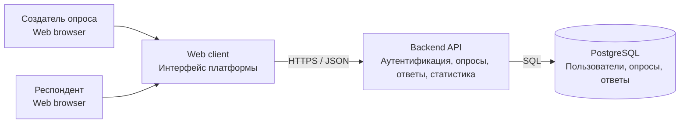
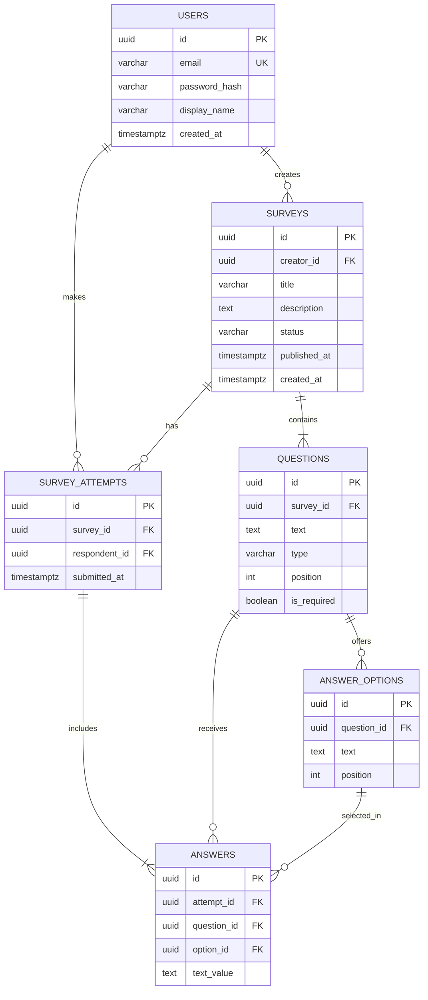

# Архитектура Survey Tool

## Краткая теория

Серверное приложение принимает запросы клиентов, выполняет бизнес-логику,
сохраняет данные и при необходимости взаимодействует с внешними системами.
До написания кода проектируют предметную область, архитектуру и базу данных:
это помогает заранее определить границы системы и избежать дублирования данных.

### Как работает серверное приложение

Клиентское приложение работает в браузере и отправляет серверу HTTP-запросы.
Сервер проверяет пользователя и входные данные, выполняет бизнес-правила,
обращается к базе данных и возвращает ответ, чаще всего в формате JSON.
Такой обмен можно представить цепочкой:

```text
Браузер -> HTTP-запрос -> Backend API -> PostgreSQL -> JSON-ответ -> Браузер
```

Например, при отправке ответов на опрос браузер передаёт идентификатор опроса
и выбранные варианты. Backend API проверяет, опубликован ли опрос и не проходил
ли пользователь его раньше. Затем он создаёт запись о прохождении и сохраняет
ответы. После этого клиент получает подтверждение.

### Архитектура и разделение ответственности

Архитектура определяет, из каких крупных частей состоит приложение и как они
взаимодействуют. В нашем случае выбрана клиент-серверная архитектура:

- Web client отображает страницы, формы и результаты опросов.
- Backend API хранит бизнес-логику, выполняет проверки прав и обрабатывает запросы.
- PostgreSQL надёжно хранит пользователей, опросы и ответы.

Внутри Backend API логика должна быть разделена на модули: аутентификация,
опросы, прохождения и статистика. Это модульный монолит: приложение
развёртывается как единый сервер, но код не смешивает несвязанные обязанности.
Такой подход проще для небольшой системы, чем микросервисы, и позволяет позднее
выделить отдельный модуль в сервис, если это действительно понадобится.

### Модель предметной области

Предметная область описывает сущности системы, их свойства и связи. Для
Survey Tool основными сущностями являются пользователь, опрос, вопрос,
вариант ответа, прохождение опроса и ответ. Такая модель отвечает на вопрос,
какие данные нужны системе и как они связаны между собой.

При моделировании полезно сначала сформулировать бизнес-правила, а затем
выделять сущности. Правило «один пользователь проходит опрос только один раз»
приводит к сущности `survey_attempts` и уникальному ограничению на пару
`survey_id` и `respondent_id`. Правило «вопросы бывают разных типов» приводит
к полю `type` у вопроса. Так требования превращаются в структуру данных,
которую можно проверить на уровне базы данных.

### C4 Model

C4 Model - подход к документированию архитектуры на нескольких уровнях.
Название C4 происходит от четырёх уровней детализации: System Context,
Container, Component и Code. Чем ниже уровень, тем больше технических деталей.

- **System Context (Level 1)** показывает Survey Tool как единый продукт,
  его пользователей и внешние системы. Здесь не рисуют таблицы и внутренние модули.
- **Container (Level 2)** показывает крупные технические части: Web client,
  Backend API, PostgreSQL, а при наличии - Redis или брокер сообщений.
- **Component (Level 3)** раскрывает внутреннюю структуру одного контейнера,
  например контроллеры, сервисы и репозитории Backend API.
- **Code (Level 4)** отражает классы или модули кода и обычно нужен только для
  сложных частей реализации.

В лабораторной требуется Level 2. Наша диаграмма показывает, что Web client
отправляет HTTP-запросы в Backend API, а API выполняет SQL-запросы к PostgreSQL.
Это позволяет объяснить путь данных от действия пользователя до их хранения.

### ERD и третья нормальная форма

ERD (Entity-Relationship Diagram) показывает таблицы базы данных, их поля и
связи через первичные и внешние ключи. Третья нормальная форма (3НФ) означает,
что данные об одной сущности хранятся в отдельной таблице, а неключевые поля
зависят только от её ключа. Благодаря этому данные не дублируются, их проще
изменять и поддерживать в согласованном состоянии.

Первичный ключ (Primary Key, PK) уникально определяет запись в таблице. Для
проекта используются UUID: они удобны при создании идентификаторов на сервере
и не раскрывают количество записей. Внешний ключ (Foreign Key, FK) хранит
идентификатор связанной записи и защищает ссылочную целостность. Например,
`questions.survey_id` указывает, к какому опросу относится вопрос.

В ERD применяются следующие типы связей:

- один ко многим: один опрос содержит много вопросов;
- один ко многим: один вопрос содержит много вариантов ответа;
- один ко многим: одно прохождение содержит много ответов;
- многие ко многим реализуется через промежуточную таблицу, если требуется.

Нормализация выполняется по шагам. Первая нормальная форма требует хранить в
поле одно неделимое значение, вторая устраняет зависимость от части составного
ключа, а третья устраняет зависимость неключевых полей друг от друга. В нашей
схеме имя пользователя хранится в `users`, текст вопроса - в `questions`, а
выбранный вариант - в `answers`; поэтому изменение одного вида данных не
требует копировать его в другие таблицы.

### Ограничения и индексы

Ограничения переносят важные бизнес-правила из кода в базу данных. `NOT NULL`
запрещает пустое обязательное поле, `UNIQUE` не даёт повторять значение,
`CHECK` ограничивает допустимые состояния. Например, email пользователя
должен быть уникальным, статус опроса может быть только `draft`, `published`
или `closed`, а повторное прохождение блокируется уникальной парой
`survey_id, respondent_id`.

Индекс ускоряет поиск и соединение таблиц. Индексы особенно нужны для внешних
ключей и полей, по которым часто выбирают данные. В Survey Tool это
`creator_id` при выводе опросов автора, `survey_id` при загрузке вопросов и
`respondent_id` при проверке прохождений пользователя. Индексы ускоряют чтение,
но немного замедляют запись, поэтому их добавляют осмысленно.

### Как теория применяется в этой работе

| Теоретическое понятие | Реализация в Survey Tool |
| --- | --- |
| Предметная область | Выделены пользователи, опросы, вопросы, варианты, прохождения и ответы. |
| Use Cases | Для создателя и респондента описаны действия в системе. |
| C4 Container | Показаны Web client, Backend API, PostgreSQL и их связи. |
| ERD | Описаны таблицы, поля, первичные и внешние ключи. |
| 3НФ | Каждая сущность хранится отдельно, данные не дублируются. |
| Ограничения | Email уникален, типы и статусы ограничены, повторное прохождение запрещено. |

## Описание проекта

Survey Tool - серверное приложение для создания и прохождения опросов.
Создатель опроса формирует вопросы, настраивает доступность и просматривает
результаты. Респондент отвечает на вопросы и может пройти каждый опрос только
один раз.

## Роли и Use Cases

### Создатель опроса

- Регистрируется и входит в систему.
- Создаёт, редактирует и удаляет черновики опросов.
- Добавляет вопросы и варианты ответов.
- Публикует и закрывает опрос.
- Просматривает агрегированные результаты.

### Респондент

- Регистрируется и входит в систему.
- Просматривает список доступных опросов.
- Открывает опрос и отправляет ответы.
- Просматривает подтверждение прохождения.

## Правила предметной области

- Опрос создаётся одним пользователем и состоит из одного или нескольких вопросов.
- Вопрос имеет тип: один вариант, несколько вариантов или текстовый ответ.
- Варианты задаются только для вопросов с выбором.
- Респондент может отправить только одно прохождение одного опроса.
- Ответ принадлежит одному прохождению и одному вопросу.

## C4 Container



Исходник диаграммы: [diagrams/c4-container.mmd](diagrams/c4-container.mmd).

## ERD базы данных



Исходник диаграммы: [diagrams/erd.mmd](diagrams/erd.mmd).

### Ограничения и индексы

- `users.email` - `UNIQUE NOT NULL`.
- `survey_attempts(survey_id, respondent_id)` - `UNIQUE`, запрещает повторное прохождение.
- `questions(survey_id, position)` и `answer_options(question_id, position)` - `UNIQUE`.
- Для внешних ключей создаются индексы: `surveys.creator_id`, `questions.survey_id`,
  `answer_options.question_id`, `survey_attempts.survey_id`,
  `survey_attempts.respondent_id`, `answers.attempt_id`, `answers.question_id`.
- `surveys.status` содержит только `draft`, `published` или `closed`.
- `questions.type` содержит только `single_choice`, `multiple_choice` или `text`.
- `answers.option_id` используется для выбора варианта, `answers.text_value` - для текстового ответа.

Схема находится в третьей нормальной форме: пользователи, опросы, вопросы,
варианты и ответы хранятся в отдельных таблицах, а неключевые поля зависят
только от ключей своих таблиц.

## Контрольные вопросы лабораторной №1

### 1. Чем отличается монолитная архитектура от микросервисной? Какие плюсы и минусы у каждого подхода?

Монолитная архитектура - это одно приложение, в котором аутентификация,
опросы, ответы и статистика развёртываются вместе. Её преимущества - простой
запуск, отладка и развёртывание, а также отсутствие сетевого взаимодействия
между внутренними модулями. Недостаток состоит в том, что при росте проекта
сложнее независимо масштабировать и выпускать отдельные части системы.

Микросервисная архитектура разделяет систему на независимые сервисы, например
сервис аутентификации, сервис опросов и сервис статистики. Это позволяет
масштабировать и развёртывать их отдельно, но требует более сложной
инфраструктуры: сетевого взаимодействия, мониторинга, обработки ошибок и
согласования данных. Для небольшого Survey Tool выбран модульный монолит,
поскольку он проще и соответствует текущему масштабу задачи.

### 2. Что такое третья нормальная форма (3НФ) и зачем ей следовать при проектировании БД?

Таблица находится в 3НФ, если она описывает одну сущность, а её неключевые
поля зависят от первичного ключа и не зависят друг от друга. Нормализация
уменьшает дублирование и предотвращает аномалии обновления, вставки и удаления.

В Survey Tool данные вынесены в отдельные таблицы `users`, `surveys`,
`questions`, `answer_options`, `survey_attempts` и `answers`. Поэтому смена
имени пользователя выполняется один раз в таблице пользователей, а не во всех
его ответах; связи между данными задаются внешними ключами.

### 3. Какую роль в архитектуре серверного приложения выполняет слой бизнес-логики (Domain / Service layer)?

Слой бизнес-логики реализует правила предметной области и координирует
сценарии работы системы. Он не должен зависеть от HTTP, конкретной базы данных
или пользовательского интерфейса. Контроллер принимает запрос и передаёт его
сервису, сервис проверяет правила, при необходимости обращается к репозиториям,
а затем возвращает результат контроллеру.

В Survey Tool сервисный слой проверяет, опубликован ли опрос, имеет ли автор
право его изменять, заполнены ли обязательные вопросы и не проходил ли
респондент этот опрос ранее. Благодаря этому одинаковые правила используются
во всех API-эндпоинтах и их проще тестировать.

### 4. Зачем нужна C4 Model и чем уровень Container отличается от уровня Component?

C4 Model нужна, чтобы описывать архитектуру на подходящем уровне детализации
для разных участников проекта. Она помогает быстро понять границы системы,
её крупные части и связи между ними.

Уровень Container показывает крупные запускаемые или хранимые части системы:
Web client, Backend API, PostgreSQL, Redis и другие сервисы. Он отвечает на
вопрос, из каких технологических блоков состоит система и как они общаются.
Уровень Component рассматривает один конкретный контейнер изнутри. Например,
в Backend API можно показать `AuthController`, `SurveyController`,
`SurveyService` и `SurveyRepository`. Component даёт больше деталей для
разработчика, а Container удобен для общей архитектурной картины.

### 5. В чём разница между связями 1:N и N:M в БД, и как реализуется связь N:M в реляционных СУБД?

Связь 1:N означает, что одной записи первой таблицы соответствует много
записей второй таблицы, а каждая запись второй таблицы относится только к
одной записи первой. В Survey Tool один опрос содержит много вопросов,
поэтому внешний ключ `questions.survey_id` хранится в таблице `questions`.

Связь N:M означает, что каждая запись обеих таблиц может быть связана со
многими записями другой таблицы. В реляционной базе её реализуют через
промежуточную таблицу с двумя внешними ключами. Например, если в системе
появятся теги, связь опросов и тегов будет реализована таблицей
`survey_tags(survey_id, tag_id)`. Такая таблица может хранить и дополнительные
свойства связи, например дату добавления тега.

## Лабораторная работа №2. REST API и OpenAPI

### Краткая теория

REST API - это контракт взаимодействия между клиентом и сервером. Ресурсы
обозначаются существительными во множественном числе, например `/surveys`, а
действие задаётся HTTP-методом. `GET` получает данные, `POST` создаёт ресурс,
`PATCH` частично изменяет его, а `DELETE` удаляет. URI содержит путь к ресурсу,
query-параметры используются для фильтрации и пагинации, а тело запроса - для
сложных входных данных.

OpenAPI 3.0 описывает этот контракт в YAML или JSON: пути, методы, параметры,
тела запросов, ответы, коды статуса и модели данных. По файлу `openapi.yaml`
Swagger UI строит интерактивную документацию, а клиентская и серверная части
согласуют API до начала реализации.

### REST API Specs

| Метод | URI | Описание | Доступ | Успешный код |
| --- | --- | --- | --- | --- |
| `POST` | `/api/v1/auth/register` | Регистрация пользователя и выдача JWT. | Все | `201 Created` |
| `POST` | `/api/v1/auth/login` | Вход в систему и получение JWT. | Все | `200 OK` |
| `GET` | `/api/v1/surveys` | Получение списка опубликованных опросов. | Все | `200 OK` |
| `POST` | `/api/v1/surveys` | Создание опроса с вопросами. | Создатель опроса | `201 Created` |
| `GET` | `/api/v1/surveys/{surveyId}` | Получение одного опроса для просмотра или прохождения. | Авторизованный пользователь | `200 OK` |
| `PATCH` | `/api/v1/surveys/{surveyId}` | Частичное изменение собственного черновика опроса. | Создатель опроса | `200 OK` |
| `DELETE` | `/api/v1/surveys/{surveyId}` | Удаление собственного черновика опроса. | Создатель опроса | `204 No Content` |
| `POST` | `/api/v1/surveys/{surveyId}/attempts` | Отправка ответов на опубликованный опрос. | Респондент | `201 Created` |

### Правила API

- Защищённые операции используют заголовок `Authorization: Bearer <JWT>`.
- Идентификаторы передаются в path-параметрах в формате UUID.
- Список опросов можно фильтровать параметром `status`; по умолчанию видны только опубликованные опросы.
- `401 Unauthorized` означает, что токен отсутствует или недействителен; `403 Forbidden` - пользователь вошёл в систему, но не является владельцем опроса.
- Сервер возвращает ошибки в едином формате `ErrorResponse` с кодом, сообщением и временем ошибки.
- Нельзя отправить повторное прохождение одного опроса: сервер вернёт `409 Conflict`.

### Контрольные вопросы лабораторной №2

#### 1. В чём разница между Query, Path и Request Body? Как выбирать способ передачи параметров?

Path-параметр идентифицирует конкретный ресурс: `/surveys/{surveyId}`. Query-параметр уточняет запрос к коллекции, например `/surveys?status=published`; он подходит для фильтрации, сортировки и пагинации. Request Body передаёт сложные данные для создания или изменения ресурса, например вопросы и варианты ответов при `POST /surveys`. Идентификатор ресурса передают в path, необязательные параметры получения - в query, а содержимое создаваемого или изменяемого ресурса - в body.

#### 2. Что такое идемпотентность HTTP-методов?

Идемпотентный запрос при повторной отправке приводит к тому же конечному состоянию ресурса. `GET` только читает данные, `PUT` повторно устанавливает одинаковое состояние, а `DELETE` после первого удаления оставляет ресурс удалённым, поэтому они считаются идемпотентными. `POST` обычно неидемпотентен: два одинаковых запроса на создание могут создать два разных ресурса.

#### 3. Когда возвращаются 401 Unauthorized и 403 Forbidden?

`401 Unauthorized` возвращается, если пользователь не предоставил токен или предоставил просроченный либо недействительный токен. `403 Forbidden` возвращается, если пользователь успешно аутентифицирован, но не имеет права выполнить действие. Например, респондент получит `403`, если попытается изменить опрос другого создателя.

#### 4. Зачем нужны `components/schemas` и `$ref` в OpenAPI?

`components/schemas` хранит переиспользуемые модели данных в одном месте. `$ref` ссылается на такую модель из операций API. Это устраняет копирование одинаковых описаний, например `ErrorResponse`, и гарантирует, что все эндпоинты используют одну версию схемы.

#### 5. В чём разница между PUT и PATCH?

`PUT` заменяет ресурс целиком: клиент передаёт полное новое представление. `PATCH` изменяет только переданные поля. В Survey Tool `PATCH /surveys/{surveyId}` подходит для изменения названия, описания или статуса черновика без повторной отправки всех вопросов.

## Лабораторная работа №3. Каркас приложения

### Выбранный стек и структура

Для базового сервера выбраны Python и FastAPI. FastAPI предоставляет
маршрутизацию, валидацию моделей Pydantic и Swagger UI по адресу `/docs`, а
слои приложения не смешиваются с деталями HTTP-фреймворка. Сервер запускается
командой `python -m cmd.app.main` после установки зависимостей из
`requirements.txt`; `HTTP_PORT` из `.env` при этом определяет порт сервера.
Структура реализует Layered Architecture:

```text
cmd/app/main.js                    Точка входа и создание HTTP-сервера
internal/config/config.js          Загрузка и проверка переменных окружения
internal/controller/               HTTP-слой и маршрутизация
internal/service/                  Бизнес-логика приложения
internal/repository/               Будущие адаптеры PostgreSQL
.env.example                       Публикуемый шаблон конфигурации
.env                               Локальная конфигурация, исключённая из Git
```

Зависимости направлены сверху вниз: controller вызывает service, service в
будущем будет обращаться к repository, а repository будет работать с базой
данных. Контроллер не содержит бизнес-правил и не обращается к БД напрямую.

### Конфигурация окружения

`internal/config/config.js` читает `.env`, но переменные окружения процесса
имеют приоритет. Поддерживаются `APP_NAME`, `APP_VERSION`, `APP_ENV` и
`HTTP_PORT`. Порт проверяется при запуске: он должен быть целым числом от 1 до
65535. В Git хранится только `.env.example`; `.env` добавлен в `.gitignore`.

### Health check

Реализован endpoint `GET /api/v1/health`. Он не требует аутентификации и
возвращает `200 OK` с JSON-данными о сервисе:

```json
{
  "status": "pass",
  "appName": "Survey Tool API",
  "version": "1.0.0",
  "environment": "development",
  "uptimeSeconds": 0
}
```

Этот endpoint используют браузер, мониторинг и оркестраторы контейнеров, чтобы
понять, что HTTP-сервер запущен и способен обработать запрос.

FastAPI загружает `openapi.yaml`, созданный во второй лабораторной, как
единственную OpenAPI-спецификацию. Поэтому Swagger UI по `/docs` показывает
контракт опросов, аутентификации и прохождений вместе с реализованным health
check. Сейчас реально работает health check; остальные методы остаются
спроектированным контрактом до следующих лабораторных работ.

### Запуск и проверка

```bash
python -m venv .venv
.venv\Scripts\activate
pip install -r requirements.txt
python -m cmd.app.main
curl http://localhost:8080/api/v1/health
```

### Контрольные вопросы лабораторной №3

#### 1. Почему Service Layer не должен знать о деталях HTTP-запросов?

Сервисный слой реализует сценарии и правила предметной области, поэтому он не
должен зависеть от JSON, HTTP-заголовков и кодов статуса. Тогда одинаковую
бизнес-логику можно вызвать из HTTP API, CLI-задачи или теста. Контроллер
преобразует HTTP-запрос в данные для сервиса и преобразует результат сервиса в
HTTP-ответ.

#### 2. Чем опасно хранение секретов непосредственно в исходном коде?

Секреты попадают в Git-историю, pull request, резервные копии и на компьютеры
всех участников проекта. Удаление строки из последнего коммита не удаляет её
из истории. Утечка пароля к БД или API-ключа может дать постороннему доступ к
данным и внешним сервисам. Поэтому секреты передают через переменные окружения
или специализированное хранилище секретов.

#### 3. Зачем нужен `.env.example`, если `.env` находится в `.gitignore`?

`.env.example` документирует все обязательные параметры и безопасные значения
по умолчанию без реальных паролей и ключей. Новый разработчик копирует его в
`.env` и заполняет локальные секреты. Так проект легко настроить, не раскрывая
конфиденциальную конфигурацию.

#### 4. Для чего используется endpoint Health Check (`/health`)?

Health Check позволяет автоматически проверить, что приложение запущено и
отвечает по HTTP. Его используют балансировщики, Docker, Kubernetes, системы
мониторинга и разработчики при локальном запуске. Если endpoint не отвечает
или возвращает ошибку, инфраструктура может не направлять трафик на экземпляр
либо перезапустить его.

#### 5. Что такое Dependency Inversion и как оно помогает связывать слои?

Dependency Inversion означает, что высокоуровневая бизнес-логика не зависит
от низкоуровневых деталей, например от конкретной СУБД или HTTP-фреймворка.
Service Layer задаёт нужный ему контракт репозитория, а PostgreSQL-адаптер его
реализует. Благодаря этому реальное хранилище можно заменить тестовой
реализацией, не переписывая бизнес-правила.

## Лабораторная работа №4. Контейнеризация Docker

### Docker-образ и контейнер

Docker упаковывает приложение, его зависимости и минимальное окружение в
неизменяемый образ (image). Контейнер - это запущенный экземпляр образа.
Благодаря этому Survey Tool одинаково запускается на компьютере разработчика,
на тестовом сервере и в облаке, без зависимости от версий Python и библиотек
хостовой системы.

В проект добавлены `.dockerignore` и `Dockerfile`. `.dockerignore` исключает
из контекста сборки Git-историю, `.venv`, Python-кэш, `.env`, IDE-настройки и
документацию. Это уменьшает размер контекста и не позволяет случайно добавить
секреты в образ.

### Dockerfile

Dockerfile использует `python:3.12-slim` - небольшой официальный базовый образ
Python. Сначала копируется только `requirements.txt` и устанавливаются
зависимости. Затем копируются исходный код и `openapi.yaml`. Такое разделение
сохраняет слой с зависимостями в кэше Docker: изменение кода не требует заново
скачивать FastAPI и Uvicorn.

Приложение запускается от отдельного непривилегированного пользователя
`appuser`, а не от root. `EXPOSE 8080` документирует порт контейнера.
`HEALTHCHECK` периодически обращается к `/api/v1/health` внутри контейнера,
позволяя Docker отметить нездоровый экземпляр.

### Запуск контейнера

```bash
docker build -t survey-tool-api:lab4 .
docker run --name survey-tool-api -d -p 8080:8080 --env-file .env survey-tool-api:lab4
curl http://localhost:8080/api/v1/health
```

Флаг `-p 8080:8080` сопоставляет порт 8080 хоста с портом приложения внутри
контейнера. `--env-file .env` передаёт настройки без встраивания их в образ.
FastAPI слушает `0.0.0.0`, поэтому запрос с хостовой машины достигает
контейнера.

### Состав контейнеризации

| Файл | Назначение |
| --- | --- |
| `Dockerfile` | Описывает образ: базовый Python, установку зависимостей, копирование кода, пользователя, порт и health check. |
| `.dockerignore` | Не отправляет в Docker-контекст `.git`, виртуальное окружение, кэш, логи, IDE-файлы и локальный `.env`. |
| `.env.example` | Показывает безопасный шаблон параметров приложения, включая `APP_HOST=0.0.0.0`. |
| `.env` | Передаётся контейнеру через `--env-file`, но не попадает в Git и образ. |

Контейнер не содержит исходную папку проекта целиком: в образ копируются только
`cmd`, `internal`, `openapi.yaml` и `requirements.txt` — то есть файлы, которые
нужны приложению во время работы. Это уменьшает размер образа и исключает
случайное попадание учебных материалов или локальных данных.

### Результат практической проверки

Проверка выполнена локально в Docker Desktop:

```text
docker build -t survey-tool-api:lab4 .     -> образ собран успешно
docker run ... -p 8080:8080 ...            -> контейнер запущен
docker ps                                  -> Up (healthy), 0.0.0.0:8080->8080/tcp
GET /api/v1/health                         -> 200 OK
```

Фактический ответ приложения:

```json
{
  "status": "pass",
  "app_name": "Survey Tool API",
  "version": "1.0.0",
  "environment": "development",
  "uptime_seconds": 12
}
```

Это подтверждает, что приложение запускается не только из виртуального
окружения на хосте, но и внутри изолированного Docker-контейнера; порт доступен
с Windows, а встроенный `HEALTHCHECK` распознаёт контейнер как исправный.

### Контрольные вопросы лабораторной №4

#### 1. В чём главное отличие виртуальной машины от Docker-контейнера?

Виртуальная машина виртуализирует аппаратное обеспечение и запускает полную
гостевую операционную систему со своим ядром. Контейнер изолирует процессы,
файловую систему и сеть, но использует ядро хостовой ОС. Поэтому контейнеры
обычно быстрее запускаются и требуют меньше памяти и места на диске.

#### 2. Зачем нужен `.dockerignore` и к чему приводит его отсутствие?

`.dockerignore` ограничивает файлы, передаваемые Docker во время сборки. Без
него в контекст могут попасть `.git`, `.venv`, тестовые артефакты, логи и
секреты из `.env`. Сборка станет медленнее, образ - больше, а конфиденциальные
данные могут оказаться в истории слоёв образа.

#### 3. Что такое multi-stage build и какие преимущества он даёт?

Multi-stage build использует один этап для сборки или компиляции и другой,
минимальный этап для запуска готового результата. Во второй этап копируются
только нужные артефакты. Это уменьшает размер итогового образа, сокращает
поверхность атаки и не переносит компиляторы и инструменты сборки в production.
Для интерпретируемого FastAPI-проекта применяется компактный образ
`python:3.12-slim`; отдельный builder здесь не даёт заметной выгоды.

#### 4. Почему в Dockerfile отдельно копируют файлы зависимостей и исходный код?

Docker кэширует каждый слой. Пока `requirements.txt` не меняется, слой с
`pip install` можно повторно использовать. Изменение одного Python-файла
пересобирает только последующие слои с кодом, поэтому повторная сборка идёт
быстрее.

#### 5. В чём разница между EXPOSE и флагом `-p`?

`EXPOSE 8080` лишь документирует, какой порт использует приложение внутри
образа, и не делает его доступным снаружи. Флаг `-p 8080:8080` при `docker run`
создаёт фактическое сопоставление порта хоста и порта контейнера. Для доступа
из браузера или curl обычно нужны оба: EXPOSE для понятности и `-p` для сети.

## Лабораторная работа №5. PostgreSQL, миграции и Docker Compose

Цель работы — запустить Survey Tool вместе с PostgreSQL и хранить структуру
базы в версионируемых SQL-миграциях. Compose поднимает `db`, проверяет её
готовность через `pg_isready`, затем запускает `migrate`. FastAPI стартует
после успешного завершения мигратора. Имя `db` разрешается внутри сети Compose.
Именованный том `pgdata` хранит данные между пересозданиями контейнеров.

Миграция `000001_init_schema` создаёт пользователей, опросы, вопросы, варианты
ответов, прохождения и ответы. Первичные и внешние ключи связывают сущности,
`UNIQUE` защищает email, позиции внутри родительской записи и прохождения
от дублей, а `CHECK` ограничивает допустимые статусы, типы и форму ответа.
Индексы на внешних ключах ускоряют поиск зависимых записей. В некоторых
случаях эту роль выполняет индекс составного ограничения `UNIQUE`.

`CASCADE` удаляет зависимые части вместе с их владельцем, например варианты
вместе с вопросом. `RESTRICT` защищает историю прохождений и выбранные варианты
от удаления связанных записей. Составной внешний ключ гарантирует, что
выбранный вариант относится к указанному вопросу. При реализации приёма
ответов сервису также потребуется проверить принадлежность вопроса опросу
прохождения и допустимое число выбранных вариантов по типу вопроса.

`golang-migrate` хранит применённую версию в `schema_migrations`. Скрипт
`up` создаёт схему в транзакции, а `down` удаляет таблицы в обратном порядке.
Откат начальной миграции удаляет содержимое этих таблиц.

При старте FastAPI проверяет обязательные переменные БД и ждёт подключения
до 20 секунд. Пул Psycopg переиспользует соединения, повторяет неудачные
попытки подключения с задержкой и ограничивает размер параметром `DB_MAX_CONNS`.
`GET /api/v1/health` проверяет выполнение `SELECT 1` и возвращает `200` при
доступной БД или `503`, если связь потеряна после запуска.
Команды запуска и проверки приведены в README.

## Лабораторная работа 6 Слой доступа к данным

Цель работы — отделить доступ к данным от бизнес-логики Survey Tool и проверить
репозитории на PostgreSQL со схемой из ЛР №5.

### Реализация

- [Доменные модели](internal/domain/models.py) описывают пользователя, опрос
  и вопрос. Хеш пароля доступен для проверки учётных данных и исключён из
  JSON, словарной сериализации и текстового представления модели.
- [Контракты](internal/repository/contracts.py) заданы через `Protocol`.
  Для каждой сущности есть создание, получение по UUID, список с пагинацией
  и удаление. Пользователя можно найти по email. У опроса можно изменить
  заголовок и описание.
- [Реализация PostgreSQL](internal/repository/postgres.py) указывает столбцы
  явно. `INSERT ... RETURNING` возвращает значения, сгенерированные БД.
  `UPDATE ... RETURNING` позволяет обнаружить отсутствие записи, а
  `DELETE` проверяет `rowcount`. В списках есть стабильный порядок с UUID,
  отрицательный offset отклоняется, размер страницы ограничен 100 строками.
- При старте FastAPI создаёт репозитории с общим пулом и размещает их в
  `app.state` для подключения к сервисам предметной области.

| Ситуация | Ошибка репозитория | HTTP-статус при подключении к API |
| --- | --- | --- |
| Запись отсутствует | `ErrNotFound` | 404 |
| Нарушена уникальность, SQLSTATE 23505 | `ErrAlreadyExists` | 409 |
| Нарушена ссылка, SQLSTATE 23503 | `ErrConflict` | 409 |
| Нарушен CHECK или NOT NULL, некорректное значение | `ErrInvalidInput` | 400 |
| Другая ошибка хранилища | `RepositoryError` | 500 |

Проверки охватывают создание и чтение всех трёх сущностей, заполнение значений
на стороне PostgreSQL, отсутствие записи, нарушение ограничений, пагинацию,
обновление, удаление и ввод с SQL-синтаксисом в поиске по email. Каждая
проверка работает в собственной транзакции с откатом. Вложенные точки
сохранения позволяют проверять ожидаемые ошибки и продолжать тест.

### Контрольные вопросы

1. **Что даёт Repository?** Он предоставляет операции предметной области,
   например поиск пользователя по email, и скрывает SQL, драйвер и устройство
   таблиц. HTTP-обработчик разбирает запрос и формирует ответ, а бизнес-логика
   вызывает репозиторий через контракт.
2. **Как параметры защищают от SQL-инъекции?** В Psycopg текст запроса
   содержит `%s`, а значения передаются отдельно в `execute`. Кавычки и
   операторы во введённом email обрабатываются как данные. Имена столбцов,
   таблиц и направление сортировки задают явно или выбирают из белого списка.
3. **Зачем преобразовывать ошибки драйвера?** Сервис получает ошибки
   предметной области и может работать с другим хранилищем. Преобразование
   в HTTP-код выполняет контроллер или обработчик исключений API.
4. **Чем отличаются SQL, Query Builder и ORM?** При прямом SQL запрос и
   сопоставление полей задаются вручную. Query Builder помогает собирать
   условия и параметры из программных выражений. ORM сопоставляет объекты
   с таблицами и сокращает код CRUD, при этом разработчик следит за формой
   и числом генерируемых запросов.
5. **Что такое ACID и как передать транзакцию?** Атомарность объединяет
   операции в одно целое, согласованность сохраняет инварианты, изоляция
   регулирует видимость параллельных изменений, долговечность сохраняет
   подтверждённый результат. Для нескольких операций сервис открывает
   общую транзакцию и передаёт репозиториям одно соединение через поставщик
   соединений. В тестах такой способ используется с точками сохранения.
6. **Зачем порядок с уникальным столбцом при пагинации?** Он однозначно
   упорядочивает строки с одинаковыми значениями сортировки. Большой
   `OFFSET` требует пропустить много строк. Для длинных списков можно
   продолжать выборку от ключа последней строки.
7. **Как интерфейс помогает тестировать сервис?** В тест передают подмену с
   теми же методами и заранее заданными результатами или ошибками.
   SQL и ограничения схемы отдельно проверяют на настоящем PostgreSQL.


## Лабораторная работа 7 Сервисный слой и REST API

### Назначение сервисного слоя

Сервисный слой описывает сценарии использования системы и проверяет правила
предметной области. В Survey Tool такими сценариями стали создание пользователя,
создание черновика опроса и его публикация. Сервис получает репозитории через
конструктор и управляет порядком операций. При прямом вызове из Python действуют
те же правила, что при вызове из HTTP.

Контроллер принимает HTTP-запрос, разбирает DTO, вызывает сервис и формирует
HTTP-ответ. Репозиторий выполняет SQL и преобразует ошибки драйвера в доменные.
Сервис связывает эти части в законченную бизнес-операцию.

```text
HTTP → DTO запроса → контроллер → сервис → репозитории → PostgreSQL
HTTP ← DTO ответа  ← контроллер ← доменные модели     ← строки БД
```

Основные изменения ЛР 7:

- `UserService` предоставляет создание, чтение, список, обновление и удаление
  пользователей; нормализует email и имя, проверяет значения и хеширует пароль.
- `SurveyService` создаёт черновик с вопросами и вариантами, возвращает детали
  опроса и выполняет публикацию с проверкой состояния и содержимого.
- Контроллеры в `internal/controller/resource_controller.py` подключают эти
  сервисы к REST API. Зависимости FastAPI получают их из `app.state`.
- `internal/controller/dto.py` задаёт отдельные модели запросов и ответов.
- `internal/controller/errors.py` централизует преобразование ошибок в HTTP.

### DTO и доменные модели

DTO определяет публичную структуру данных конкретного запроса или ответа.
Доменные модели `User`, `Survey`, `Question` и `AnswerOption` используются внутри
приложения. `SurveyDetail` объединяет опрос с вопросами и вариантами для сценария
получения подробностей. `QuestionDraft` и `OptionDraft` передают сервису данные
создаваемых вопросов без зависимости от HTTP.

В API используются имена `displayName`, `creatorId`, `createdAt`, `publishedAt`
и `isRequired`. В Python соответствующие поля записываются в snake_case.
Pydantic Field с alias задаёт это соответствие. Контроллер явно преобразует
доменную модель в DTO через `from_domain`, а DTO вопроса в команду сервиса —
через `to_domain`. `extra="forbid"` отклоняет неизвестные поля.

Проверка DTO выявляет неверную форму запроса, тип UUID и превышение объявленных
размеров. Сервис проверяет предметные ограничения, например готовность к
публикации. Ограничения PostgreSQL обеспечивают целостность при сохранении.
Хеш пароля исключён из модели пользователя при сериализации; в `UserResponse`
поля пароля и хеша также отсутствуют.

### Сервисы и внедрение зависимостей

`UserService` получает объект, соответствующий `UserRepository`. `SurveyService`
получает `SessionFactory` и функцию времени `Clock`. В `lifespan` приложения
сначала открывается пул, затем создаются репозитории и сервисы. FastAPI `Depends`
доставляет нужный сервис контроллеру.

В модульных тестах вместо PostgreSQL передаются Mock-объекты. Время публикации
берётся из переданной функции, поэтому тест фиксирует точное `publishedAt`.
Это позволяет проверять бизнес-логику без подключения к БД и без отдельного
HTTP-сервера. HTTP-слой отдельно проверяется TestClient с заменой зависимостей.

### Бизнес правила опроса

| Условие | Ошибка | HTTP |
| --- | --- | --- |
| Создатель должен существовать | `ErrNotFound` | 404 |
| Название после trim содержит 3–200 символов | `ErrInvalidInput` | 400 |
| Позиции вопросов и вариантов положительны и уникальны в своём родителе | `ErrInvalidInput` | 400 |
| Публикация разрешена для `draft` | `ErrConflict` | 409 |
| Для публикации нужен хотя бы один вопрос | `ErrInvalidInput` | 400 |
| У вопроса с выбором перед публикацией минимум два варианта | `ErrInvalidInput` | 400 |
| Текстовый вопрос не содержит вариантов выбора | `ErrInvalidInput` | 400 |

Черновик разрешено сохранить пустым или с неполным набором вариантов.
При публикации сервис повторно проверяет сохранённые данные. Ограничены
размеры опроса, вопросов и вариантов. Повторная публикация возвращает конфликт.

### Транзакция создания и защита публикации

Создание опроса меняет несколько таблиц: `surveys`, `questions`,
`answer_options`. `session_factory` выдаёт репозитории с одним соединением
в общей транзакции. Её граница соответствует вызову бизнес-операции сервиса.
При ошибке вставки варианта откатываются также опрос и уже созданные вопросы.
Это поведение проверяет `test_postgres_transactions.py` на PostgreSQL.

При публикации `get_for_update` читает строку опроса через `SELECT ... FOR UPDATE`.
Проверка статуса и запись `published` выполняются в той же транзакции.
Второй запрос публикации ждёт освобождения строки и затем видит новое состояние.
Приёмочная проверка двух параллельных запросов дала один ответ 200 и один 409.
Защита действует для сценария публикации через эту транзакционную сессию.
При добавлении изменений вопросов их потребуется согласовать с той же блокировкой.

### HTTP операции и единый формат ошибок

| Метод | Путь | Результат |
| --- | --- | --- |
| POST | `/api/v1/users` | 201, `Location`, DTO пользователя |
| GET | `/api/v1/users?limit=2&offset=0` | 200, список |
| GET | `/api/v1/users/{id}` | 200, DTO пользователя |
| PUT | `/api/v1/users/{id}` | 200, обновлённые email и displayName |
| DELETE | `/api/v1/users/{id}` | 204, пустое тело |
| POST | `/api/v1/surveys` | 201, `Location`, черновик с вопросами |
| GET | `/api/v1/surveys/{id}` | 200, подробности опроса |
| POST | `/api/v1/surveys/{id}/publish` | 200, опубликованный опрос |

PUT заменяет все изменяемые публичные поля пользователя. Пароль задаётся при
создании и хешируется scrypt с отдельной случайной солью. Вход и смена пароля
потребуют отдельных сценариев.

Доменная ошибка выражает причину отказа и не содержит HTTP-кода. Общий
обработчик сопоставляет `ErrInvalidInput` с 400, `ErrNotFound` с 404,
`ErrAlreadyExists` и `ErrConflict` с 409. Остальные ошибки получают 500
с нейтральным сообщением. Ответ содержит `code`, `message`, `timestamp`.
Ошибки разбора UUID, JSON и DTO тоже приведены к 400. Проверка health сохраняет
специальное поведение 200/503 из предыдущих работ.

### OpenAPI и проверка результата

Swagger строится из реализованных маршрутов и DTO. `openapi.yaml` содержит
снимок той же OpenAPI 3.1 схемы, совпадение проверяется тестом. Контракт ЛР 2
уточнён в ветке ЛР 7 под реально реализованные операции. Доступ в этой версии
не требует JWT; `creatorId` передаётся в запросе явно. Публикация реализована,
а закрытие опроса, изменение его вопросов и отправка ответов остаются дальнейшими
сценариями. `closed` пока присутствует как допустимое значение модели и БД.

Результат разработки проверен 18 модульными проверками, 6 интеграционными
проверками репозиториев ЛР 6, проверкой атомарного отката и 22 HTTP-проверками.
Последние охватывают П1–П9 задания и параллельную публикацию. Команды и
пошаговый сценарий Swagger приведены в README и [LAB7.md](LAB7.md).

### Вопросы для подготовки к защите

1. **Почему правила находятся в сервисе?** Сервис сохраняет одинаковое
   поведение при HTTP-вызове и прямом вызове, а контроллер отвечает за транспорт.
2. **Для чего DTO?** Он фиксирует формат API и ограничивает публичные поля,
   например исключает пароль и хеш из ответа пользователя.
3. **Как зависимости помогают тестированию?** Вместо реальных репозиториев
   передают заглушки, а вместо системных часов — фиксированную функцию времени.
4. **Почему сервис поднимает доменные ошибки?** Причина отказа сохраняется
   независимо от способа вызова; транспортный слой выбирает HTTP-код.
5. **Какие коды используются?** Создание — 201 с Location, чтение и изменение —
   200, удаление — 204 без тела, неверные данные — 400, отсутствие — 404,
   конфликт — 409, непредвиденный сбой — 500.
6. **Зачем передавать время?** Публикация использует предсказуемый источник UTC,
   а тесты получают воспроизводимое значение без ожидания реальных часов.
7. **Где граница транзакции?** Она охватывает бизнес-операцию; в реализации
   сервис открывает транзакционную сессию для всех нужных репозиториев.
8. **Как защищена проверка состояния?** Чтение с блокировкой и изменение
   выполняются в одной транзакции, поэтому повторная публикация видит конфликт.

### Общая база и резервное копирование

Для ручной работы ЛР 5–7 используется проект Compose `rsp-lab6-demo` и его
существующий том PostgreSQL. Имя проекта Docker не связано с именем Git-ветки.
Код ЛР 7 находится в `feature/lab7-service`. API доступен на 8080,
DBeaver подключается к 127.0.0.1:15432, контейнер приложения — к db:5432.

Перед откатом начальной миграции выполняется `backup-db.cmd`.
`restore-db.cmd` восстанавливает выбранный архив схемы и записей.
Копии хранятся в игнорируемой Git папке backups. Сам `migrate down 1`
удаляет данные приложения; обычный Compose `down` без `-v` сохраняет том.
